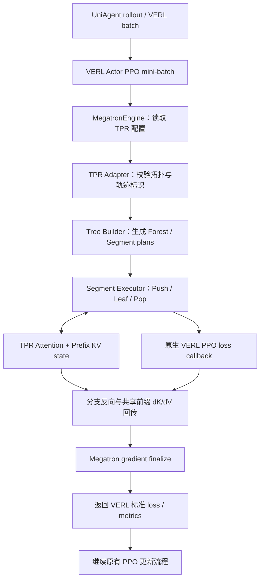

# TPR Recipe：架构与 VERL 集成说明

本文说明 TPR Recipe 的目录职责、与 VERL 现有训练框架的连接点，以及一批 PPO 轨迹在 TPR 路径中的执行流程。目标是让评审者先理解边界与数据流，再进入具体实现。

## 1. 一句话概括

**VERL 继续负责 PPO 训练编排；TPR Recipe 提供独立的训练侧前缀复用 Runtime；一个小型、版本锁定的 Patch 将 Runtime 接入 Megatron Engine。**

TPR 不替换 VERL 的 rollout、reward、PPO Trainer、优化器或学习率调度器。未启用 `tpr_enabled` 时，执行继续走 VERL 原有路径。

## 2. Recipe 代码组织

```text
tpr/
├── main entry / integration
│   ├── run_uniagent_rebench_ppo.sh  # UniAgent + SWE-ReBench PPO 示例入口
│   ├── verl-tpr.patch               # 针对固定 VERL revision 的最小集成补丁
│   ├── REQUIRED_VERL.txt            # 记录 Patch 对应的上游版本
│   ├── pyproject.toml               # 独立 Python 包元数据
│   ├── README.md                    # 安装与运行指引
│   └── ARCHITECTURE.md              # 本文：框架改动与执行流程
└── verl_tpr/
    ├── __init__.py                   # 包导出
    ├── adapter.py                   # VERL Engine 与 TPR Runtime 的适配入口
    ├── tree.py                      # 轨迹分组、树/森林执行计划与目标引用
    ├── executor.py                  # Segment 的 Push / Leaf / Pop 执行与反向传播
    ├── attention.py                 # 将共享前缀状态接入模型 Attention
    ├── context.py                   # 单次 Segment forward 的 Attention 上下文
    ├── state.py                     # Prefix KV、栈状态及延迟 dK/dV 累加
    ├── objective.py                 # 将原生 VERL PPO loss 映射到各 Segment
    ├── rectangular_attention.py      # CP=1 的矩形因果 Attention 路径
    ├── ring.py                      # Context Parallel Runtime 与 Ring 后端
    ├── ring_attention.py             # TPR 前缀块与 Ring Attention 的执行
    ├── ring_layout.py                # 序列分片、全局位置与 Ring 布局
    └── recompute.py                  # TPR 感知的重计算适配
```

Recipe 中保留的是 TPR 专属实现和运行示例，不复制完整 VERL 仓库。实验用例、轨迹准备、性能回放和调试脚本不属于最小 Runtime 包，应按各自用途留在测试或实验目录。

## 3. 对 VERL 现有框架的改动

固定上游版本：`2ab35292039a51175a4b3d3b3b2d76e951a0d3e4`。

Patch 只修改两个 VERL 文件，分为四个接入点：

| 官方 VERL 文件 | 接入点 | 作用 |
|---|---|---|
| `verl/workers/config/engine.py` | Engine 配置增加 `tpr_enabled`、`tpr_cp_backend` | 通过配置选择是否启用 TPR，以及指定 CP 后端 |
| `verl/workers/engine/megatron/transformer_impl.py` | 模型构建前安装 TPR ModuleSpec | 将模型 Attention 层连接到 TPR 实现；兼容对应的 ModuleSpec / MBridge 构建入口 |
| 同上 | 模型构建后按配置安装 TPR-aware full recompute | 让重计算路径能正确处理 TPR 的 KV 与梯度关系；不支持的模型分块形态会提前报错 |
| 同上 | 在原生 micro-batch 切分前路由训练请求 | 让同一逻辑 PPO mini-batch 的轨迹先进入 TPR 树形调度，而不是先被原生 micro-batch 拆散 |

### 为什么必须在 micro-batch 切分前接入？

TPR 的复用机会来自同一个逻辑 mini-batch 中多条轨迹的共享前缀。如果先按普通 micro-batch 拆分，原本可以共享的轨迹可能被分到不同批次，树构建就无法看到完整的复用关系。

因此，Patch 沿用 VERL 原有的 batch token 统计和 DP 元数据，在完成必要的 Engine 侧准备后、进入原生 micro-batch 调度前，将训练请求交给 TPR Adapter。TPR 完成当前 mini-batch 的树形前反向后，仍返回 VERL 预期的 loss 与 metrics 结构。

### 哪些框架能力保持不变？

- PPO 训练编排和策略更新流程仍由 VERL 管理。
- rollout、Agent 运行、reward 计算与数据准备不由 TPR 接管。
- TPR 复用原有的 VERL Actor loss callback，不另起一套 PPO 算法实现。
- 参数、优化器、学习率调度以及分布式进程组仍使用现有训练栈。
- 未开启 TPR 时，不走 TPR 专用训练路由；forward-only 请求也不进入 TPR PPO 训练调度。

## 4. 一次训练请求如何经过 TPR？



执行过程可以分为六步：

1. **保留逻辑批次。** Adapter 从 Actor mini-batch 读取轨迹标识及 token / response mask 等数据；优先使用显式的 TPR 轨迹键，必要时回退到 VERL 的样本 UID 与行号。
2. **构造树。** 当前生产策略为 `qwen_turn`。仅在 token 精确匹配的共享边界上构造共享节点，例如 Prompt 终点或完整 ChatML 消息边界；每条轨迹仍保留独立的 PPO 监督目标引用。
3. **执行共享前缀。** `SegmentExecutor` 按树的依赖关系执行 Push、Leaf 和 Pop。共享前缀的 KV 状态在同一执行路径上复用，叶节点计算各自的监督目标。
4. **执行原生 PPO 目标。** `SegmentPPOObjectiveAdapter` 将每个 Segment 的 logits 映射到 VERL 原来的 loss callback，并保留原始 mini-batch 的目标归一化语义。
5. **回传共享状态梯度。** 分支的反向结果通过共享 KV 状态累加并传回祖先 Segment，避免将不同轨迹的监督目标错误地合并成一个目标。
6. **完成梯度收尾。** 森林执行结束后进行一次 Engine 级梯度 finalize，并按 VERL 期望的结构返回 loss 与 metrics。

## 5. CP / Ring 与重计算的边界

- **CP=1：** 使用本地 TPR Attention 执行路径。
- **CP>1：** 当前 TPR PPO 路径要求使用 Ring CP 后端。Ring 负责序列分片及前缀 / 当前 Segment 的分布式 Attention 执行。
- **DP：** 每个 DP replica 独立构造自己的 TPR forest；不跨 DP replica 共享 Prefix KV。DP 梯度同步仍由现有 Megatron / VERL 训练路径负责。
- **重计算：** 只有在 Engine 配置了受支持的重计算模式并成功安装 TPR-aware 适配后才允许执行；仅修改配置而未安装适配会被显式拒绝。
- **Leaf batching：** 同一父节点下满足条件的等长叶节点可以在 CP=1 下分组执行；当前这不改变 VERL 的 PPO 编排，且不应被描述为 CP Ring 路径的通用能力。

## 6. 当前支持范围与限制

本 Recipe 对应的是当前实现范围，不代表所有 Megatron 并行组合均已支持。

| 项目 | 当前代码中的限制 |
|---|---|
| 模型 | Dense Qwen / GPT 类路径；MoE、MTP 等不支持路径会显式拒绝 |
| TP / CP | TP=1 支持 CP=1/2；TP=2 支持 CP=1/2/4，且 CP>1 需要 Ring |
| DP | 常规支持 DP=1；生产 DP=2 组合目前限制为 TP=2、CP=2 |
| PP / VPP / EP | 当前训练路径要求 PP=EP=1，且只有一个模型 chunk |
| Sequence Parallel | TP>1 与 CP>1 同时启用 SP 的组合尚未验证；当前要求关闭 SP |
| 训练模式 | TPR 专用路由是 Actor forward/backward 训练路径，不是通用 inference / forward-only 路径 |
| PPO 目标 | 当前 Segment 目标适配限制为 vanilla policy loss 与 token-mean 聚合 |

超出支持范围的配置应在训练前失败，而不是静默回退或在一次 PPO 更新中途才暴露错误。

## 7. 为什么使用 Recipe + 小型 Patch？

1. **业务实现独立演进。** TPR Runtime 可以在自己的目录中测试和迭代，不要求把所有实验与实现文件塞进 VERL 主仓。
2. **框架侵入面小。** 上游接入集中在 Engine 配置、模型构建和训练路由三个职责，便于审查和维护。
3. **默认路径清晰。** TPR 通过显式配置启用，普通训练仍走原有 VERL 路径。
4. **版本可复现。** Patch 与固定 VERL revision 配套，避免依赖隐式的上游代码状态。
5. **评审边界明确。** 本 PR 的核心是 TPR Recipe 和可复现入口；性能数字、数值对齐与 NPU 端到端验收应由对应实验结果单独支撑。

## 8. 验收状态

本文描述当前 Recipe 分支的代码结构与接入设计。公开提交前仍应在干净的固定版本 VERL checkout 上完成：

- `git apply --check` 与实际 Patch 应用；
- Python 包导入和 Hydra / Engine 配置检查；
- 最小 NPU PPO smoke test；
- Full / TPR 以及 recompute on / off 的最终对比实验；
- 对应性能、显存、前缀复用率和正确性结论的结果归档。

在上述检查完成前，Patch 与统一启动脚本应标记为待验收草稿，而不应宣称已经在干净上游环境中完成端到端验证。
