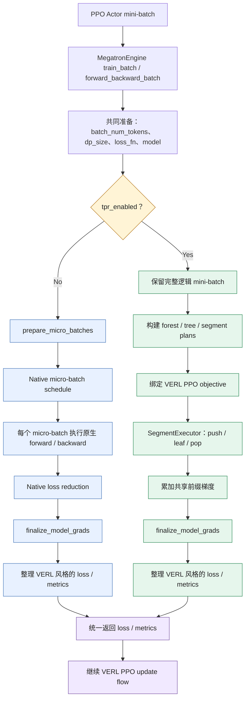

# TPR Recipe：架构与 VERL 集成说明

本文说明 TPR Recipe 的目录职责、与 VERL 现有训练框架的连接点，以及一批 PPO 轨迹在 TPR 路径中的执行流程。目标是让评审者先理解边界与数据流，再进入具体实现。

## 1. 一句话概括

**VERL 继续负责 PPO 训练编排；TPR Recipe 提供独立的训练侧前缀复用 Runtime；一个小型、版本锁定的 Patch 将 Runtime 接入 Megatron Engine。**

TPR 不替换 VERL 的 rollout、reward、PPO Trainer、优化器或学习率调度器。未启用 `tpr_enabled` 时，执行继续走 VERL 原有路径。

## 2. Recipe 代码组织

```text
tpr/
├── main entry / integration
│   ├── run_uniagent_rebench_ppo.sh  # UniAgent + SWE-ReBench PPO 示例入口
│   ├── verl-tpr.patch               # 针对固定 VERL revision 的最小集成补丁
│   ├── REQUIRED_VERL.txt            # 记录 Patch 对应的上游版本
│   ├── pyproject.toml               # 独立 Python 包元数据
│   ├── README.md                    # 安装与运行指引
│   └── ARCHITECTURE.md              # 本文：框架改动与执行流程
└── verl_tpr/
    ├── __init__.py                   # 包导出
    ├── adapter.py                   # VERL Engine 与 TPR Runtime 的适配入口
    ├── tree.py                      # 轨迹分组、树/森林执行计划与目标引用
    ├── executor.py                  # Segment 的 Push / Leaf / Pop 执行与反向传播
    ├── attention.py                 # 将共享前缀状态接入模型 Attention
    ├── context.py                   # 单次 Segment forward 的 Attention 上下文
    ├── state.py                     # Prefix KV、栈状态及延迟 dK/dV 累加
    ├── objective.py                 # 将原生 VERL PPO loss 映射到各 Segment
    ├── rectangular_attention.py      # CP=1 的矩形因果 Attention 路径
    ├── ring.py                      # Context Parallel Runtime 与 Ring 后端
    ├── ring_attention.py             # TPR 前缀块与 Ring Attention 的执行
    ├── ring_layout.py                # 序列分片、全局位置与 Ring 布局
    └── recompute.py                  # TPR 感知的重计算适配
```

Recipe 中保留的是 TPR 专属实现和运行示例，不复制完整 VERL 仓库。实验用例、轨迹准备、性能回放和调试脚本不属于最小 Runtime 包，应按各自用途留在测试或实验目录。

## 3. 对 VERL 现有框架的改动

固定上游版本：`2ab35292039a51175a4b3d3b3b2d76e951a0d3e4`。

TPR 对使用者只暴露一个全局开关：**`tpr_enabled`**。

- `tpr_enabled = false`：走 VERL 原生 Actor 训练执行路径。
- `tpr_enabled = true`：在满足 TPR 支持条件时，走 TPR Runtime。
- CP 沿用 VERL 已有的 `context_parallel_size` 配置，不再提供独立的 TPR CP backend 选择项。
- `context_parallel_size = 1` 时使用本地 TPR Attention；`context_parallel_size > 1` 时自动使用当前支持的 Ring CP 路径。

### Patch 接入点

| 官方 VERL 文件 | 修改职责 | 为什么需要 |
|---|---|---|
| `verl/workers/config/engine.py` | 增加唯一的 TPR 开关 `tpr_enabled` | 让用户通过一个配置选择 Native 或 TPR，不增加单独的 CP backend 开关 |
| `verl/workers/engine/megatron/transformer_impl.py` | 模型构建前安装 TPR Attention ModuleSpec | 将模型的 Attention 调用接入 TPR Runtime |
| 同上 | 按现有重计算配置安装 TPR-aware recompute | 使重计算路径正确处理 TPR 的共享 KV 和梯度关系 |
| 同上 | 在原生 micro-batch 切分 / DCP 调度之前分叉 | TPR 必须先看到完整逻辑 mini-batch，才能在多条轨迹之间构造共享前缀树 |

### 为什么分叉点必须在 micro-batch 切分之前？

VERL 进入 `MegatronEngine.forward_backward_batch()` 后，会先完成两条路径都需要的通用准备，包括全局监督 token 数、DP 元信息，以及相关的模型并行检查。

随后才决定执行路径：

- **Native 路线**：进入 VERL 原生的 DCP 调度或 `prepare_micro_batches()`，再按原生 Megatron forward/backward schedule 执行。
- **TPR 路线**：保留完整逻辑 mini-batch，先构造 forest / segment plans，再由 TPR Executor 安排共享前缀与叶子分支的前反向执行。

如果 TPR 在原生 micro-batch 切分之后才介入，共享前缀轨迹可能已经分散到不同 micro-batch，Runtime 就无法在原本的逻辑批次范围内发现并复用这些前缀。

### 哪些框架能力保持不变？

- PPO 训练编排、rollout、Agent 运行、reward 计算和数据准备仍由 VERL / 上层应用负责。
- TPR 复用 VERL 原有的 Actor loss callback，不另起一套 PPO 算法。
- 参数、优化器、学习率调度和分布式进程组仍使用现有训练栈。
- 未启用 TPR 时，训练继续走原生执行路径；forward-only 请求也不会进入 TPR PPO 专用路由。
- 两条路线在各自完成梯度收尾并整理结果后，统一返回 VERL 预期的 loss / metrics 结构。

## 4. 一次训练请求如何经过 TPR？

同一个 PPO Actor mini-batch 在 Engine 完成公共准备后，根据 `tpr_enabled` 分成 Native 和 TPR 两条执行路线；两条路线完成各自的前反向与梯度收尾后，统一返回 VERL 需要的 loss / metrics。



**图中需要记住的两个位置：**

- **分叉点：** Engine 完成公共准备后、原生 `prepare_micro_batches` 之前。Native 路线照常切分 micro-batch；TPR 路线保留完整逻辑 mini-batch，以便构建共享前缀树。
- **汇合点：** 两条路线各自完成 `finalize_model_grads` 和 loss / metrics 整理后，统一返回 VERL。上层 PPO update flow 不需要改变。

## 5. CP / Ring 与重计算的边界

- **唯一的用户开关：** `tpr_enabled`。TPR 不额外暴露 CP backend 选择项。
- **CP=1：** 使用本地 TPR Attention 执行路径。
- **CP>1：** 复用 VERL 已有的 `context_parallel_size` 配置，自动选择当前支持的 Ring CP 路径；用户不需要再设置第二个 TPR 开关或选择其他 CP backend。
- **DP：** 每个 DP replica 独立构造自己的 TPR forest；不跨 DP replica 共享 Prefix KV。DP 梯度同步仍由现有 Megatron / VERL 训练路径负责。
- **重计算：** 按现有 Engine 重计算配置安装 TPR-aware 适配；不把重计算策略扩展成 TPR 的第二个全局开关。当前仅支持已验证的配置组合。
- **Leaf batching：** 同一父节点下满足条件的等长叶节点可以在 CP=1 下分组执行；当前这不改变 VERL 的 PPO 编排，且不应被描述为 CP Ring 路径的通用能力。

## 6. 当前支持范围与限制

本 Recipe 对应的是当前实现范围，不代表所有 Megatron 并行组合均已支持。

| 项目 | 当前代码中的限制 |
|---|---|
| 模型 | Dense Qwen / GPT 类路径；MoE、MTP 等不支持路径会显式拒绝 |
| TP / CP | TP=1 支持 CP=1/2；TP=2 支持 CP=1/2/4，且 CP>1 需要 Ring |
| DP | 常规支持 DP=1；生产 DP=2 组合目前限制为 TP=2、CP=2 |
| PP / VPP / EP | 当前训练路径要求 PP=EP=1，且只有一个模型 chunk |
| Sequence Parallel | TP>1 与 CP>1 同时启用 SP 的组合尚未验证；当前要求关闭 SP |
| 训练模式 | TPR 专用路由是 Actor forward/backward 训练路径，不是通用 inference / forward-only 路径 |
| PPO 目标 | 当前 Segment 目标适配限制为 vanilla policy loss 与 token-mean 聚合 |

超出支持范围的配置应在训练前失败，而不是静默回退或在一次 PPO 更新中途才暴露错误。

## 7. 为什么使用 Recipe + 小型 Patch？

1. **业务实现独立演进。** TPR Runtime 可以在自己的目录中测试和迭代，不要求把所有实验与实现文件塞进 VERL 主仓。
2. **框架侵入面小。** 上游接入集中在 Engine 配置、模型构建和训练路由三个职责，便于审查和维护。
3. **默认路径清晰。** TPR 通过显式配置启用，普通训练仍走原有 VERL 路径。
4. **版本可复现。** Patch 与固定 VERL revision 配套，避免依赖隐式的上游代码状态。
5. **评审边界明确。** 本 PR 的核心是 TPR Recipe 和可复现入口；性能数字、数值对齐与 NPU 端到端验收应由对应实验结果单独支撑。

## 8. 验收状态

本文描述当前 Recipe 分支的代码结构与接入设计。公开提交前仍应在干净的固定版本 VERL checkout 上完成：

- `git apply --check` 与实际 Patch 应用；
- Python 包导入和 Hydra / Engine 配置检查；
- 最小 NPU PPO smoke test；
- Full / TPR 以及 recompute on / off 的最终对比实验；
- 对应性能、显存、前缀复用率和正确性结论的结果归档。

在上述检查完成前，Patch 与统一启动脚本应标记为待验收草稿，而不应宣称已经在干净上游环境中完成端到端验证。
